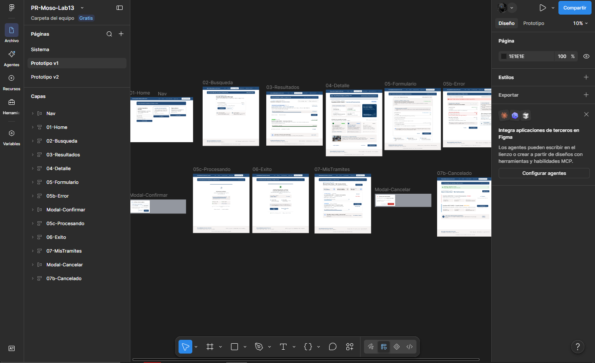

# Laboratorio N° 13: Prototipado interactivo y testing con usuarios

**Repositorio GitHub:** [https://github.com/josueshadow-24/PR-Moso-Lab13.git](https://github.com/josueshadow-24/PR-Moso-Lab13.git)

**Producto:** Portal de atención ciudadana y trámites en línea – Municipalidad Distrital de El Porvenir

**Archivo Principal PR-Moso-Lab13:** [...](...)

**Archivo Testing PR-Moso-Lab13-Testing:** [...](...)

---

## Paso 1: Preparación del archivo y definición de flujos

| N° | Flujo (objetivo del usuario) | Pantalla inicial | Pantallas involucradas | Criterio de éxito |
| :--- | :--- | :--- | :--- | :--- |
| **F1** | Consultar estado de un expediente municipal | `01-Home` | `01-Home`, `02-Busqueda`, `03-Resultados`, `04-Detalle` | Llega al detalle del expediente consultado y visualiza su estado |
| **F2** | Solicitar una Licencia de Funcionamiento | `04-Detalle` | `04-Detalle`, `05-Formulario`, `05b-Error`, `Modal-Confirmar`, `05c-Procesando`, `06-Exito` | Completa la solicitud y visualiza la constancia de registro exitoso |
| **F3** | Anular una solicitud de trámite en curso | `01-Home` | `01-Home`, `07-MisTramites`, `Modal-Cancelar`, `07b-Cancelado` | El trámite deja de figurar activo en Mis Trámites |

### Diagrama de flujo de usuario

### Inventario de pantallas y modales (`Prototipo v1`)

Se diseñaron y estandarizaron **12 frames** en la página `Prototipo v1` del archivo `PR-Moso-Lab13` utilizando instancias vinculadas al sistema de diseño (`Button`, `Input`, `Card`), prefijos numéricos sin espacios y nomenclatura homologada en capas compartidas para soportar transiciones con **Smart Animate**:

- **Flujo F1 (Consulta):** `01-Home`, `02-Busqueda`, `03-Resultados`, `04-Detalle`
- **Flujo F2 (Licencia):** `05-Formulario`, `05b-Error`, `Modal-Confirmar`, `05c-Procesando`, `06-Exito`
- **Flujo F3 (Anulación):** `07-MisTramites`, `Modal-Cancelar`, `07b-Cancelado`

## Paso 2: Componentes interactivos (`Sistema`)

### 2.1 Estados hover en `Button` (`Mouse enter` / `Mouse leave`)
Se configuraron transiciones interactivas bidireccionales en las variantes `Primary`, `Secondary` y `Ghost` del component set `Button` utilizando `Mouse enter` y `Mouse leave` (evitando *While hovering* para conservar compatibilidad con eventos `On click` de navegación):

