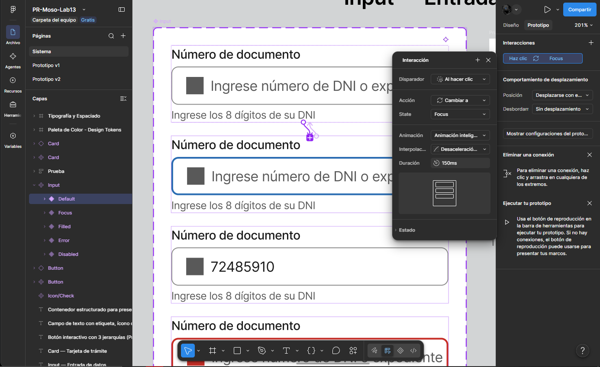
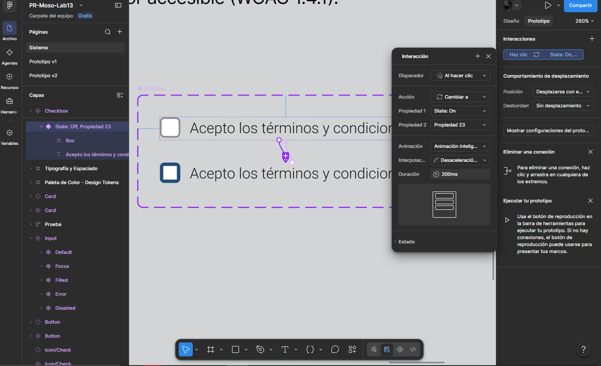
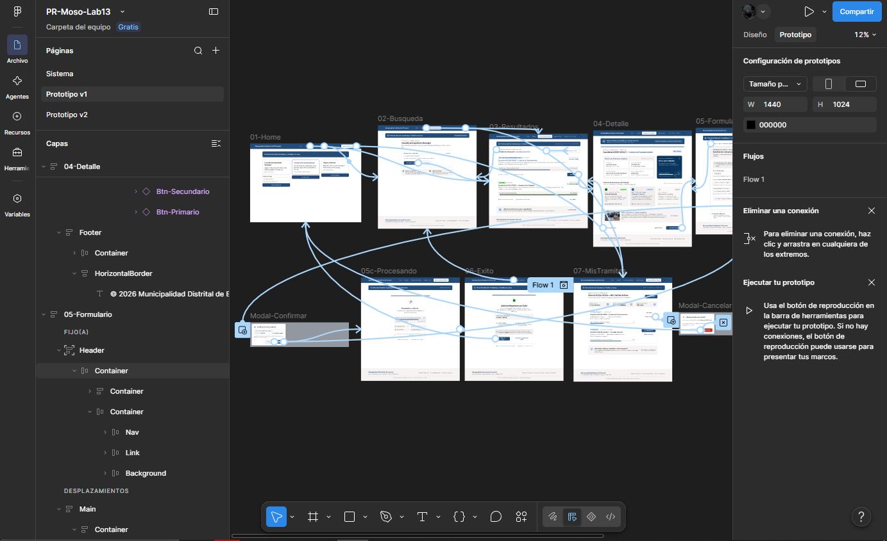
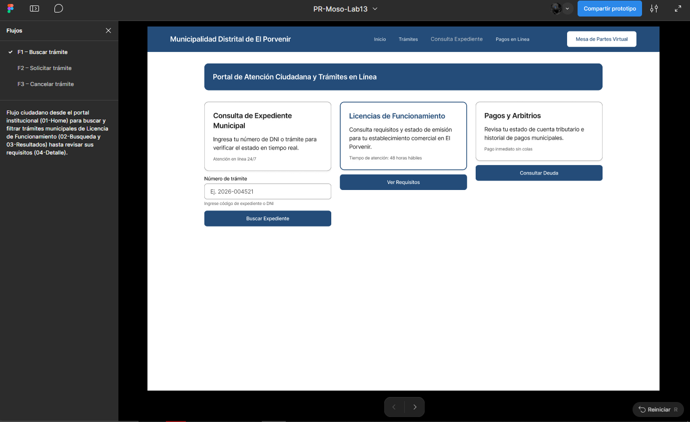
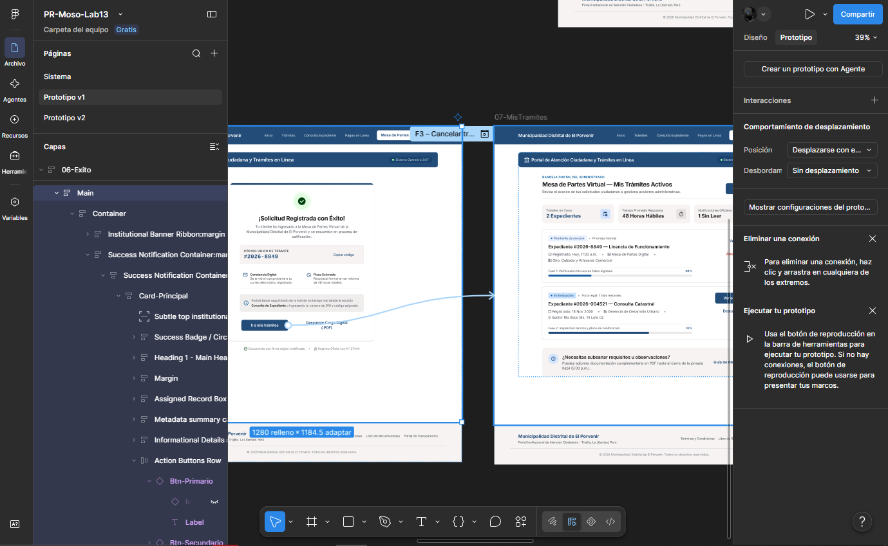
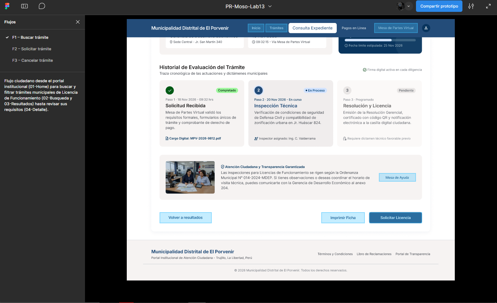
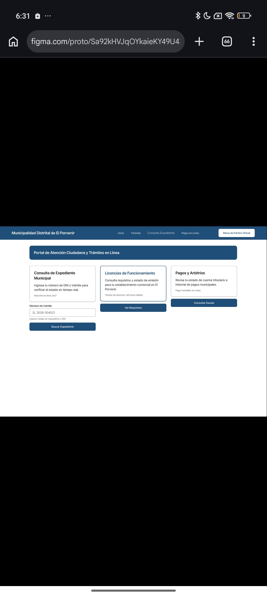

# Laboratorio N° 13: Prototipado interactivo y testing con usuarios

**Repositorio GitHub:** [https://github.com/josueshadow-24/PR-Moso-Lab13.git](https://github.com/josueshadow-24/PR-Moso-Lab13.git)

**Producto:** Portal de atención ciudadana y trámites en línea – Municipalidad Distrital de El Porvenir

**Archivo Principal PR-Moso-Lab13:** [...](...)

**Archivo Testing PR-Moso-Lab13-Testing:** [...](...)

---

## Paso 1: Preparación del archivo y definición de flujos

| N° | Flujo (objetivo del usuario) | Pantalla inicial | Pantallas involucradas | Criterio de éxito |
| :--- | :--- | :--- | :--- | :--- |
| **F1** | Consultar estado de un expediente municipal | `01-Home` | `01-Home`, `02-Busqueda`, `03-Resultados`, `04-Detalle` | Llega al detalle del expediente consultado y visualiza su estado |
| **F2** | Solicitar una Licencia de Funcionamiento | `04-Detalle` | `04-Detalle`, `05-Formulario`, `05b-Error`, `Modal-Confirmar`, `05c-Procesando`, `06-Exito` | Completa la solicitud y visualiza la constancia de registro exitoso |
| **F3** | Anular una solicitud de trámite en curso | `01-Home` | `01-Home`, `07-MisTramites`, `Modal-Cancelar`, `07b-Cancelado` | El trámite deja de figurar activo en Mis Trámites |

### Diagrama de flujo de usuario

### Inventario de pantallas y modales (`Prototipo v1`)

Se diseñaron y estandarizaron **12 frames** en la página `Prototipo v1` del archivo `PR-Moso-Lab13` utilizando instancias vinculadas al sistema de diseño (`Button`, `Input`, `Card`), prefijos numéricos sin espacios y nomenclatura homologada en capas compartidas para soportar transiciones con **Smart Animate**:

- **Flujo F1 (Consulta):** `01-Home`, `02-Busqueda`, `03-Resultados`, `04-Detalle`
- **Flujo F2 (Licencia):** `05-Formulario`, `05b-Error`, `Modal-Confirmar`, `05c-Procesando`, `06-Exito`
- **Flujo F3 (Anulación):** `07-MisTramites`, `Modal-Cancelar`, `07b-Cancelado`

## Paso 2: Componentes interactivos (`Sistema`)

### 2.1 Estados hover en `Button` (`Mouse enter` / `Mouse leave`)
Se configuraron transiciones interactivas bidireccionales en las variantes `Primary`, `Secondary` y `Ghost` del component set `Button` utilizando `Mouse enter` y `Mouse leave` (evitando *While hovering* para conservar compatibilidad con eventos `On click` de navegación):

### 2.2 Indicador de foco en `Input` (WCAG 2.4.7)
Se configuró la transición `On click → Change to → State=Focus` en el component set `Input` para evidenciar el anillo de foco al interactuar con los campos de entrada, cumpliendo con el criterio de accesibilidad WCAG 2.4.7:

### 2.3 Componente interactivo `Checkbox` (`State=Off` / `State=On`)
Se creó el component set `Checkbox` mediante Auto Layout y tokens de color/tipografía del sistema, conectando ambos estados de forma bidireccional con `On click → Change to` (`Smart Animate`, `Ease out`, `200 ms`) e integrándolo en `05-Formulario` para la aceptación de términos:

### 2.4 Validación en modo presentación (`Present`)
Se verificó en un frame de prueba (`Ctrl + Alt + Enter`) que las interacciones definidas en los componentes maestros (`Button`, `Input` y `Checkbox`) se heredan automáticamente en todas las instancias sin necesidad de reconfigurarlas pantalla por pantalla:

## Paso 3: Navegación, overlays y flujos (`Prototipo v1`)

### 3.1 Navegación base, dispositivo y scroll vertical
Se configuró el entorno de prototipado en `Desktop`, activando `Overflow → Vertical` y encabezado `Position: Fixed` en pantallas extensas, junto con las transiciones `On click → Navigate to` y acciones `Back` (`Smart Animate`, `300 ms`):

### 3.2 Superposiciones y modales (`Open overlay`)
Se configuraron `Modal-Confirmar` y `Modal-Cancelar` como frames independientes invocados mediante `Open overlay` (`Center`, `Close when clicking outside`, fondo `#000000` al `40 %`, animación `Move in ↑`, `Ease out`, `250 ms`), conectando la acción de confirmación hacia `05c-Procesando` / `06-Exito`:

### 3.3 Simulación de estado de error (`05b-Error`)
Se implementó el flujo de validación de campos obligatorios mediante el frame `05b-Error`, empleando la variante `Input (State: Error)` y mensajes de ayuda visibles (WCAG 3.3.1) antes de habilitar la apertura de `Modal-Confirmar`:

### 3.4 Puntos de inicio de flujo (`Flow Starting Points`)
Se definieron tres puntos de inicio independientes en `Prototipo v1` para evaluar cada recorrido de usuario por separado:
- **F1 – Buscar trámite (`01-Home`):** Búsqueda, filtrado y consulta de requisitos de trámites municipales.
- **F2 – Solicitar trámite (`04-Detalle`):** Llenado de solicitud, validación de error (`05b-Error`), confirmación modal (`Modal-Confirmar`) y constancia (`06-Exito`).
- **F3 – Cancelar trámite (`07-MisTramites`):** Gestión y cancelación de expedientes activos mediante `Modal-Cancelar`.

### 3.5 Matriz de interacciones principales (`Prototipo v1`)

| Elemento (frame) | Trigger | Acción | Destino | Animación |
| :--- | :--- | :--- | :--- | :--- |
| Botón `Buscar Expediente` (`01-Home`) | On click | Navigate to | `02-Busqueda` | Smart Animate · Ease out · 300 ms |
| Botón `Ver Requisitos` (`01-Home`) | On click | Navigate to | `03-Resultados` | Smart Animate · Ease out · 300 ms |
| Botón `Consultar ahora` (`02-Busqueda`) | On click | Navigate to | `03-Resultados` | Smart Animate · Ease out · 300 ms |
| Card `Licencia de Funcionamiento` (`03-Resultados`) | On click | Navigate to | `04-Detalle` | Smart Animate · Ease out · 300 ms |
| Enlace `← Catálogo de Trámites` (`04-Detalle`) | On click | Back | Frame anterior | Smart Animate · Ease out · 300 ms |
| Botón `Iniciar trámite` (`04-Detalle`) | On click | Navigate to | `05-Formulario` | Smart Animate · Ease out · 300 ms |
| Botón `Enviar Solicitud` vacío (`05-Formulario`) | On click | Navigate to | `05b-Error` | Smart Animate · Ease out · 200 ms |
| Botón `Enviar Solicitud` corregido (`05b-Error`) | On click | Open overlay | `Modal-Confirmar` | Move in ↑ · Ease out · 250 ms |
| Botón `Confirmar envío` (`Modal-Confirmar`) | On click | Navigate to | `05c-Procesando` | Dissolve · Ease out · 200 ms |
| Frame completo (`05c-Procesando`) | After delay (1200 ms) | Navigate to | `06-Exito` | Dissolve · Ease out · 300 ms |
| Enlace `Mesa de Partes Virtual` (`06-Exito` / Header) | On click | Navigate to | `07-MisTramites` | Dissolve · Ease out · 250 ms |
| Botón `Cancelar solicitud` (`07-MisTramites` / `05-Formulario`) | On click | Open overlay | `Modal-Cancelar` | Move in ↑ · Ease out · 250 ms |

Se estandarizaron las curvas y tiempos de animación (`Ease out` en navegación `250–350 ms` y `Ease in and out` en componentes `100–200 ms`). Se emparejaron las capas `expediente/title`, `expediente/badge` y `expediente/progress` entre `03-Resultados` y `04-Detalle` para generar continuidad espacial mediante `Smart Animate` (`300 ms`):

### 4.2 Microinteracción de carga, retroalimentación de exito y accesibilidad de movimiento
- **Carga (`05c-Procesando`):** Disparador `After delay (1200 ms) → Navigate to → 06-Exito` (`Dissolve`, `300 ms`), cumpliendo la Heurística 1 de Nielsen (*visibilidad del estado del sistema*).
- **Éxito (`06-Exito`):** Animación de aparición del ícono de confirmación (`Success Badge`, escala `0.8` a `1.0` con `Smart Animate` / `Spring`, `300 ms`) y acción siguiente `Ir a mis trámites` hacia `07-MisTramites`.
- **Accesibilidad (WCAG 2.3.1 / 2.4.7):** Sin destellos (>3 Hz), transiciones `≤ 300 ms` y foco visible conservado.

## Paso 5: Revisión del prototipo y prueba piloto

### 5.1 Auditoría de Hotspots, Dead Ends y dispositivo móvil
Se ejecutaron los tres flujos (`F1`, `F2`, `F3`) en modo `Present` inspeccionando *hotspots* para eliminar pantallas sin salida (*dead ends*) y se validó en dispositivo móvil real la altura mínima táctil de `44 px`, legibilidad tipográfica y funcionamiento del `Header` fijo:

### 5.2 Enlace limpio sin sesgos y versión base (`v1-prueba`)
Se configuró el enlace de presentación con permisos `Anyone with the link – can view`, desactivando *Show hotspot hints on click* y comentarios visibles para garantizar pruebas sin sesgos. Asimismo, se registró la línea base **`v1-prueba`** en el historial de versiones de Figma:

